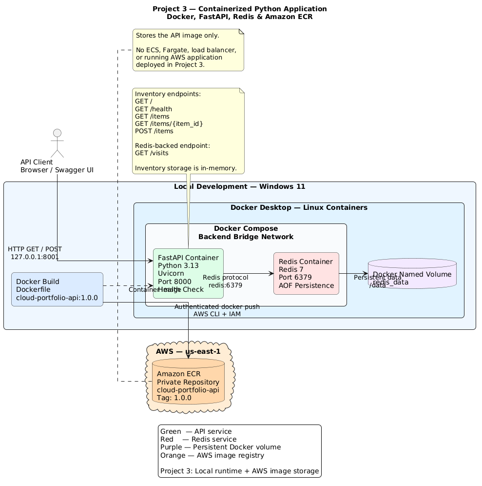

# Containerized Python API with Docker and Amazon ECR

**Cloud Engineering Portfolio — Project 3**

**Technologies:** Python · FastAPI · Docker · Docker Compose · Redis · Pytest · Amazon ECR

## Project Overview

This project demonstrates the development, testing, containerization, and publication of a Python REST API.

The application is an inventory management API built with FastAPI. It runs inside a Docker container and communicates with a Redis service using Docker Compose networking. Redis persistence is configured through a Docker-managed named volume.

After local development and testing, a versioned API container image was published to a private Amazon Elastic Container Registry (ECR) repository in AWS.

The objective was to gain practical experience with application packaging, container networking, persistent storage, automated tests, and container image management.

## Architecture



The solution consists of two distinct environments:

**Local development environment**

- A Python FastAPI application running inside a Docker container
- A Redis container for a persistent visit counter
- A Docker Compose bridge network connecting the services
- A named Docker volume retaining Redis persistence files
- Local API access through `127.0.0.1:8001`

**AWS environment**

- A private Amazon ECR repository in `us-east-1`
- A versioned API container image tagged `1.0.0`
- Authenticated image publishing through AWS CLI and Docker

Amazon ECR stores the application image. The application is not currently deployed as a continuously running AWS workload.

## API Endpoints

| Method | Endpoint | Description |
|---|---|---|
| GET | `/` | Welcome response |
| GET | `/health` | Basic application health response |
| GET | `/items` | Return inventory items |
| GET | `/items/{item_id}` | Retrieve a specific inventory item |
| POST | `/items` | Create a new inventory item |
| GET | `/visits` | Increment and return a Redis-backed visit counter |

The inventory items are stored in Python memory for demonstration purposes and are reset when the application process restarts.

The Redis visit counter uses persistent volume storage.

## Technologies and Their Roles

| Technology | Purpose |
|---|---|
| Python | Application logic |
| FastAPI | REST API framework |
| Uvicorn | ASGI application server |
| Pydantic | Request validation |
| Pytest | Automated application testing |
| Docker | Image building and container execution |
| Docker Compose | Multi-container service configuration |
| Redis | Key-value storage for the visit counter |
| Docker named volume | Persistent Redis data |
| Amazon ECR | Private container image registry |
| AWS CLI | AWS authentication and registry operations |
| Git and GitHub | Source control and documentation |

## Running Locally

### Prerequisites

- Docker Desktop with Linux containers enabled
- Docker Compose
- Python 3.13 for local Python development
- Git

### Start the application

From the project directory:

```bash
docker compose up -d --build
```

Review the running services:

```bash
docker compose ps
```

Open the API documentation:

`http://127.0.0.1:8001/docs`

Check the application:

`http://127.0.0.1:8001/health`

Test the Redis-backed counter:

`http://127.0.0.1:8001/visits`

### Inspect container logs

```bash
docker compose logs api
docker compose logs redis
```

### Stop the environment

```bash
docker compose down
```

Named volumes remain available by default.

To intentionally delete Compose-managed volumes and their data:

```bash
docker compose down -v
```

**Warning:** Removing volumes deletes the Redis persistence data used by this project.

## Automated Testing

The application includes six automated tests using Pytest and FastAPI's TestClient.

The tests verify:

- Welcome endpoint response
- Health endpoint response
- Inventory retrieval
- Handling of nonexistent inventory items
- Validation of invalid item data
- Redis visit counter behavior using a mock client

Run the tests from the project root:

```bash
python -m pytest tests -q
```

The test suite passed before the application image was published to ECR.

## Docker Image

The Dockerfile uses a Python slim base image, installs application dependencies, copies the API code, and starts Uvicorn.

Security and maintainability practices include:

- Non-root runtime user
- Docker health check
- `.dockerignore` exclusions
- Separate runtime dependencies
- Application listening on container port 8000
- Local-only host port mapping during development

Build the release image:

```bash
docker build --pull -t cloud-portfolio-api:1.0.0 .
```

## Amazon ECR Publication

**AWS Region:** `us-east-1`

**Repository:** `cloud-portfolio-api`

**Image tag:** `1.0.0`

The publishing process consisted of:

1. Creating a private ECR repository.
2. Authenticating Docker with a temporary ECR authorization token obtained through AWS CLI.
3. Tagging the locally built Docker image with the ECR repository URI.
4. Pushing the image to the registry.
5. Verifying the image tag and digest in ECR.

The image registry URI depends on the AWS account and Region.

No AWS access keys are embedded in application code or the Docker image.

## Important Design Decisions

**Why Docker?**

To package the Python application and its runtime dependencies into a reusable image.

**Why Docker Compose?**

To manage the API and Redis as related services with repeatable networking and configuration.

**Why Redis service-name networking?**

Compose provides DNS resolution between connected services, avoiding hardcoded container IP addresses.

**Why a Docker named volume?**

To demonstrate that application data can persist independently of the container lifecycle.

**Why Amazon ECR?**

To learn how container images are versioned and distributed through an AWS-managed registry, preparing for deployment with ECS Fargate.

## Limitations

This is a hands-on learning project, not a production application.

- Inventory items use in-memory storage.
- The visit counter is not an authenticated or rate-limited endpoint.
- Redis persistence is not a substitute for a database backup strategy.
- The demonstration health endpoint does not check all external dependencies.
- The API is deployed locally, not as a running AWS service.
- Production authentication, TLS termination, centralized monitoring, and scaling are outside the current scope.

## Key Lessons Learned

- How REST APIs exchange HTTP requests and JSON responses
- How Docker images differ from running containers
- How Dockerfiles define application packaging
- How container health checks work
- How Docker Compose connects services
- Why `localhost` behaves differently inside containers
- How named volumes preserve data across container recreation
- How to write automated application tests
- How to publish and verify a private image in Amazon ECR
- How to handle dependency and Docker Engine troubleshooting

## Future Improvements

The next portfolio project will use the containerized application as the foundation for automated deployment on AWS.

Planned topics include:

- Amazon ECS Fargate
- Infrastructure provisioning with Terraform
- CI/CD with GitHub Actions
- IAM authentication using OIDC
- Application monitoring with Amazon CloudWatch
- Deployment and rollback strategies

---

**Project type:** Personal Cloud Engineering and DevOps learning project.